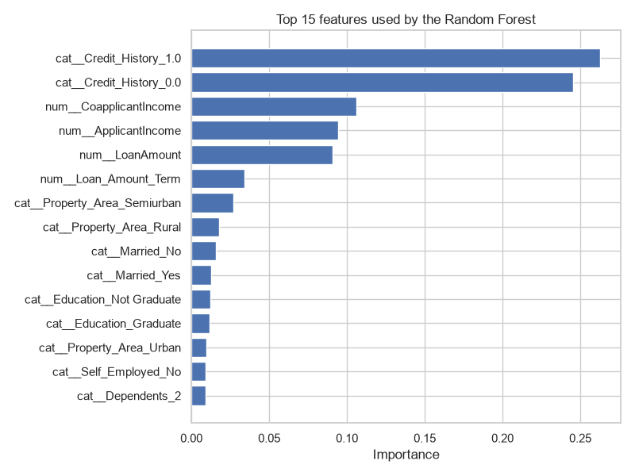

# Loan Approval Prediction

A Django web application that predicts whether a loan application would be
approved. The prediction comes from a scikit-learn Random Forest model trained
on historical loan data.

## 1. Goal

A user fills in a short form (income, loan amount, credit history, …) and the
application answers **Loan approved** or **Loan rejected**, together with the
probability of approval. No knowledge of Python or machine learning is needed
to use it.

## 2. Dataset

`data/loan_data.csv` — 381 rows, 13 columns, no duplicate rows.

The target column is **`Loan_Status`**: `Y` (approved) or `N` (rejected).
The classes are imbalanced: 271 approved (71.1%) and 110 rejected (28.9%).

## 3. Features

`Loan_ID` is dropped — it has 381 unique values for 381 rows, so it is a pure
identifier and carries no information.

**Numeric features**

| Column | Meaning | Missing |
|---|---|---|
| `ApplicantIncome` | Monthly income of the main applicant | 0 |
| `CoapplicantIncome` | Monthly income of the co-applicant (0 if none) | 0 |
| `LoanAmount` | Requested loan amount, in thousands | 0 |
| `Loan_Amount_Term` | Loan term in months (360 in 82% of the rows) | 11 |

**Categorical features**

| Column | Values | Missing |
|---|---|---|
| `Gender` | Male, Female | 5 |
| `Married` | Yes, No | 0 |
| `Dependents` | 0, 1, 2, 3+ | 8 |
| `Education` | Graduate, Not Graduate | 0 |
| `Self_Employed` | Yes, No | 21 |
| `Credit_History` | 1.0 (good), 0.0 (bad) | 30 |
| `Property_Area` | Urban, Semiurban, Rural | 0 |

`Credit_History` is stored as `0.0`/`1.0`, but it is a binary flag rather than a
quantity, so it is treated as a categorical feature.

## 4. Data preparation

Run `python -m ml.analyze_data` to reproduce the analysis. The most important
findings:

* **`Credit_History` dominates the outcome.** Applicants with a good credit
  history are approved in 82.3% of the cases, applicants with a bad one in only
  5.3%.
* **`Property_Area` matters a little**: Semiurban 79.9%, Urban 69.0%,
  Rural 61.3%.
* **The numeric features are almost unrelated to the target.** The
  point-biserial correlation with approval is below 0.05 in absolute value for
  all four of them, and the average income of approved and rejected applicants
  is nearly identical (3571 vs 3603).
* The numeric features are also weakly correlated with each other — the
  strongest pair is `ApplicantIncome` / `LoanAmount` at 0.27 — so there is no
  redundant column to remove.

Charts produced by the analysis are written to `static/images/`:
`target_distribution.png`, `numeric_distributions.png`,
`categorical_vs_target.png`, `numeric_vs_target.png`,
`correlation_heatmap.png`.

### Missing values

Handled inside the pipeline with `SimpleImputer`:

* numeric columns — filled with the **median** (robust to the income outliers);
* categorical columns — filled with the **most frequent** value.

### Categorical encoding

`OneHotEncoder(handle_unknown="ignore")`. Each category becomes its own 0/1
column. `handle_unknown="ignore"` keeps the web app from crashing if a value
that never appeared during training is ever submitted.

### Numeric scaling

`StandardScaler` — each numeric column is centred to mean 0 and scaled to
standard deviation 1.

Imputation, encoding and scaling are all steps *inside* the pipeline. They are
therefore fitted on the training folds only, which prevents test-set
information from leaking into the training data.

## 5. The ML pipeline

```
raw data
  → ColumnTransformer
       ├── numeric:     SimpleImputer(median)        → StandardScaler
       └── categorical: SimpleImputer(most_frequent) → OneHotEncoder
  → RandomForestClassifier
  → prediction
```

**Why Random Forest?**

* It works well on small tabular datasets with mixed numeric and categorical
  features, which is exactly this dataset.
* It captures non-linear rules and interactions without any manual feature
  engineering.
* Averaging many trees makes it far less prone to overfitting than a single
  decision tree — useful with only 381 rows.
* It exposes `feature_importances_`, which makes the model explainable.

`class_weight="balanced"` compensates for the 71% / 29% class imbalance.

### Train / test split

```python
train_test_split(X, y, test_size=0.2, random_state=42, stratify=y)
```

304 training rows and 77 test rows. `stratify=y` keeps the same approved /
rejected ratio in both parts, and `random_state=42` makes the run reproducible.

### GridSearchCV

5-fold cross-validation on the training set, scoring on **F1** (a better fit
than accuracy for an imbalanced target). The grid is deliberately small so the
training finishes in seconds:

| Parameter | Values tried | Best |
|---|---|---|
| `n_estimators` | 100, 300 | 300 |
| `max_depth` | None, 5, 10 | 5 |
| `min_samples_split` | 2, 5 | 2 |
| `min_samples_leaf` | 1, 3 | 1 |

Best cross-validation F1: **0.888**.

## 6. Model metrics

Measured on the 77 held-out test rows (full report in `ml/model_report.txt`):

| Metric | Value | What it means here |
|---|---|---|
| Accuracy | 0.857 | Share of all applications classified correctly. |
| Precision | 0.844 | Of the applications the model approves, 84.4% really were approved. |
| Recall | 0.982 | Of the applications that really were approved, the model finds 98.2%. |
| F1-score | 0.908 | Harmonic mean of precision and recall — one number balancing the two. |
| ROC-AUC | 0.817 | Probability that a random approved application is scored higher than a random rejected one. 0.5 = random guessing. |

Confusion matrix (rows = actual, columns = predicted):

```
                predicted N   predicted Y
actual N             12            10
actual Y              1            54
```

The model is much better at recognising approvals (recall 0.98) than rejections
(recall 0.55). It rarely refuses a good application, but it does approve 10 of
the 22 applications that were in fact rejected. That is the expected result on
a dataset where one feature carries most of the signal and the rejected class
is the minority.

## 7. Feature importance



| Feature | Importance |
|---|---|
| `Credit_History_1.0` | 0.263 |
| `Credit_History_0.0` | 0.245 |
| `CoapplicantIncome` | 0.106 |
| `ApplicantIncome` | 0.094 |
| `LoanAmount` | 0.091 |
| `Loan_Amount_Term` | 0.034 |
| `Property_Area_Semiurban` | 0.027 |

The two `Credit_History` columns together account for about 51% of the total
importance — the model's decision is driven mostly by that single flag. The
income and loan-amount columns get moderate importance largely because they are
continuous: a Random Forest has many possible split points in them, which
inflates their score even when their correlation with the target is near zero.

**Important:** feature importance shows which features the model *used* most
when making its decisions. It does **not** prove causation. The same applies to
the correlations in the analysis section: a relationship in the data is not
evidence that one variable causes the other.

## 8. Saved model

The **whole pipeline** (preprocessing + classifier) is saved with
`joblib.dump()` to `models/loan_model.joblib`. Because preprocessing travels
with the model, Django can pass the raw form values straight to
`model.predict()` and no preprocessing logic is duplicated in the web app.

## 9. Project structure

```
final_prodject/
├── manage.py
├── requirements.txt
├── README.md
│
├── config/                     # Django project settings and root URLs
│   ├── settings.py
│   ├── urls.py
│   ├── asgi.py
│   └── wsgi.py
│
├── loan_prediction/            # Django app
│   ├── templates/loan_prediction/
│   │   ├── base.html
│   │   ├── home.html           # input form
│   │   └── result.html         # prediction result
│   ├── forms.py                # LoanApplicationForm
│   ├── views.py                # loads the pipeline, makes the prediction
│   ├── urls.py
│   └── tests.py
│
├── ml/
│   ├── config.py               # dataset paths and column lists
│   ├── analyze_data.py         # exploratory analysis + charts
│   ├── train_model.py          # pipeline, GridSearchCV, evaluation, saving
│   └── model_report.txt        # generated metrics report
│
├── models/loan_model.joblib    # trained pipeline
├── data/loan_data.csv
└── static/
    ├── css/style.css
    └── images/                 # generated charts
```

The app has no `models.py`: the project does not store anything in a database,
it only reads a form and returns a prediction.

## 10. Installation

```bash
python -m venv .venv
.venv\Scripts\activate          # Windows
# source .venv/bin/activate     # Linux / macOS
pip install -r requirements.txt
```

## 11. Running the ML part

```bash
python -m ml.analyze_data     # prints the analysis, writes charts to static/images/
python -m ml.train_model      # trains, evaluates, writes models/loan_model.joblib
```

`train_model` must be run at least once before starting the web app, because
the view loads `models/loan_model.joblib`.

## 12. Running the web application

```bash
python manage.py runserver
```

Open <http://127.0.0.1:8000/>.

## 13. Using the web application

1. Fill in the form on the home page: gender, marital status, dependents,
   education, self-employment, applicant and co-applicant income, loan amount,
   loan term, credit history and property area.
2. Press **Predict**.
3. The result page shows **Loan approved** or **Loan rejected**, the approval
   probability, and a summary of what was submitted.
4. Invalid input (a negative income, an empty field, text in a number field) is
   reported next to the field in question and the form is redisplayed.

## 14. Tests

```bash
python manage.py test
```

13 tests covering the home page, the form fields, valid and invalid submissions,
the result page, and the saved pipeline itself.

## 15. Settings

`SECRET_KEY` and `DEBUG` are read from the environment
(`DJANGO_SECRET_KEY`, `DJANGO_DEBUG`) and fall back to development values, so no
secret is stored in the repository.
